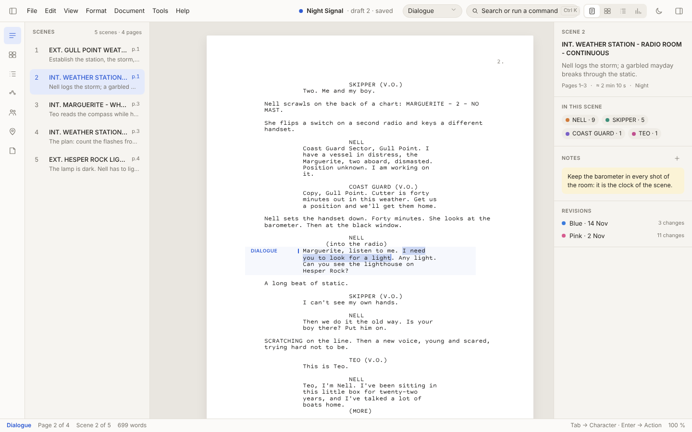
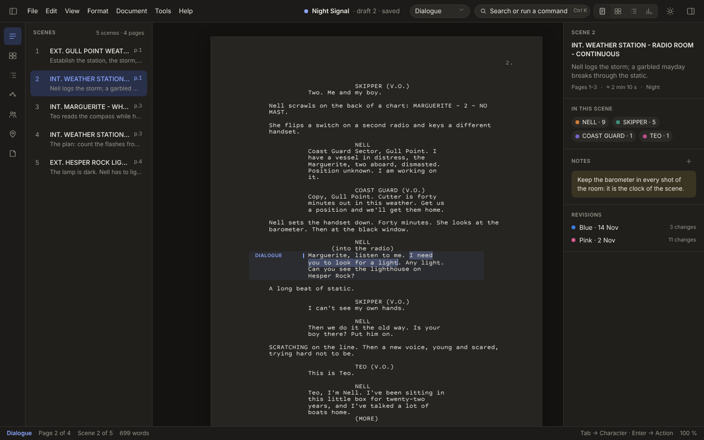
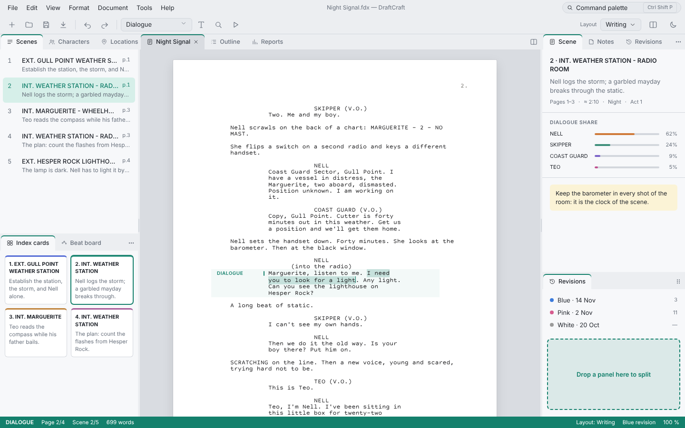
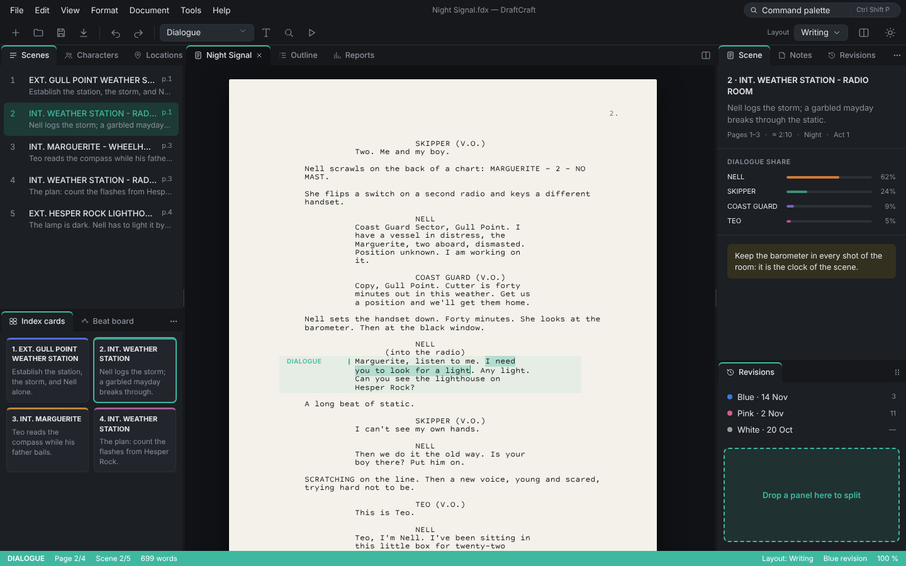
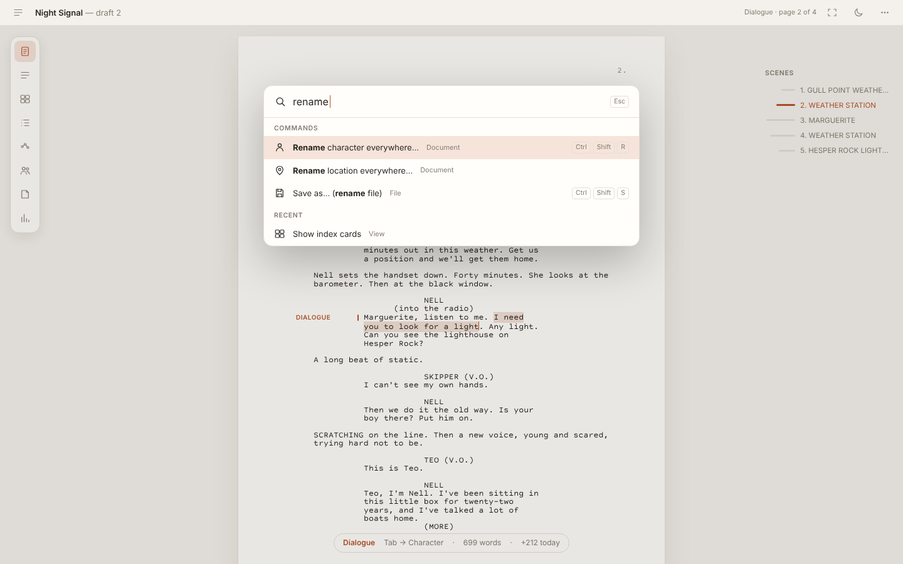
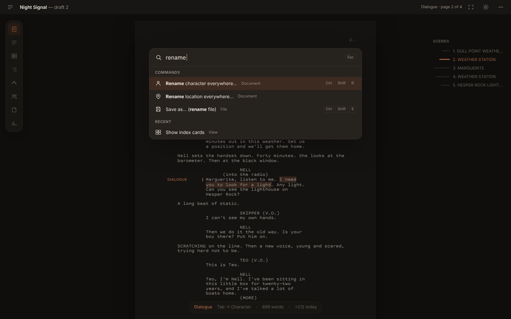

# Redesign mockups (v0.6)

Three directions for the new main window, for the owner to choose from in the issue
"Redesign: choose a direction". Nothing here is app code: the chosen variant becomes the design
tokens in `crates/ui-egui/src/theme.rs` and the window layout.

| Variant | Light | Dark |
|---|---|---|
| **A · Paper**: calm, warm, one slim top bar, icon rail + collapsible left sidebar, right context panel |  |  |
| **B · Studio**: every view is a dockable panel with tabs and splitters, layout presets, cream paper even in dark |  |  |
| **C · Focus**: almost no chrome, floating tool rail, scene minimap, command palette as the main way in |  |  |

All three share: the element of the current line in the left margin of the page, a command
palette (every command by id), the sample script "Night Signal", Courier Badi on the page.
The interface font in the mockups (Inter) is a stand-in until v0.8 chooses the bundled UI font.

Edit `redesign-mockups.html` (open it with `?v=a|b|c&theme=light|dark`) and re-render with
`node docs/design/render.mjs` (Playwright + Chromium).

## Focus, developed (direction C)

The owner asked to develop **C · Focus** further. `focus.html` shows it across the app's main
screens, in light and dark (`focus/<screen>-<theme>.png`, overview in `focus/overview-*.png`);
re-render with `node docs/design/render-focus.mjs`.

| # | Screen | What it shows |
|---|---|---|
| 1 | `write` | The page and almost nothing else: floating tool rail, scene minimap, element in the margin, a HUD pill; SmartType on a new cue |
| 2 | `typewriter` | Focus mode: all chrome hidden, the current speech in full contrast, the rest dimmed, the day's goal |
| 3 | `navigator` | The rail opens a floating panel (Scenes, Characters, Locations, Notes) and a character card: the light, self-filling bible (v0.11) |
| 4 | `cards` | Index cards on the desk, grouped by act, one being dragged, filter by character, colour by act/day/tag |
| 5 | `stats` | Writer's statistics (v0.10): KPIs, words a day against the goal, who talks, INT/EXT and day/night, the writing heat map, scene lengths, this session |
| 6 | `panels` | Movable panels (v0.6): docked Scenes and Scene panels, a panel being dragged with a dock zone and the five-way dock target, layout presets |
| 7 | `av` | The two-column audio/visual script (v0.7): Video, Audio with VO/SFX/Music/Interview tags, timing per row and in total |
| 8 | `rtl` | A Hebrew script with the interface mirrored (v0.9): rail and minimap swap sides, the element label in the right margin, mixed RTL/LTR text; the page in Liberation Mono |
| 9 | `welcome` | Start screen: continue writing, new screenplay / two-column / TV / stage play / from a file (.odt included), recent scripts, WebDAV |

Shared rules of the direction: one warm accent (terracotta) on paper and desk tones; chrome
only where the writer looks for it (rail, minimap, HUD), everything else on demand (the command
palette, floating panels); panels float over the desk or dock to its sides; the page is always
the centre.

## In the app: the design tokens

The Focus palette, type scale, spacing and radii live in `crates/ui-egui/src/theme.rs`
(`LIGHT`, `DARK`, `type_scale`, `space`, `radius`). Interface code paints with these tokens,
never with literal colours or sizes. `theme::tests::contrast_meets_wcag_aa` checks every
text/background pair against WCAG AA (4.5:1 for text, 3:1 for the accent and chart colours,
7:1 for script ink on paper); where a mockup colour fell short (`text_soft`, light `ink_soft`)
the token is a shade darker (light) or lighter (dark) than in `focus.html`.

## In the app: the icons

`crates/ui-egui/src/icons.rs` draws every interface icon in the Focus line style, the same
strokes as the `P` table in `focus.html`: a 24-unit grid, 1.6-unit strokes with round ends and
rounded corners, never filled. Each icon is a table of strokes (`icons::shapes`), painted at
any size; tests keep each icon on its grid, about the same size and centred, so the set reads
as one family. Where the mockups have no icon (Save, Export PDF, Undo/Redo, Dual dialogue,
Scene numbers, Title page, Story map, Split screen) it is drawn in the same manner.

## In the app: dialogs

`crates/ui-egui/src/dialog.rs` draws every redesigned dialog the same way: a `pop` card with
the large radius and a soft shadow, a heading in the type scale with a close cross (no system
title bar), roomy margins, and a footer under a hairline with the buttons on the right and the
main action last, filled with the accent. Questions that must be answered first ("Save
changes?", "Save changes first?", "Recover unsaved changes?") are modal: the desk dims under
the `scrim` token and Escape or a click outside means Cancel (never for the recovery question,
so an autosave is not lost by accident). Done so far: Title Page, About and those three
questions; the other dialogs (element settings, page setup, find and replace, collaboration,
print, revisions, track changes, read aloud) move to it one by one.
